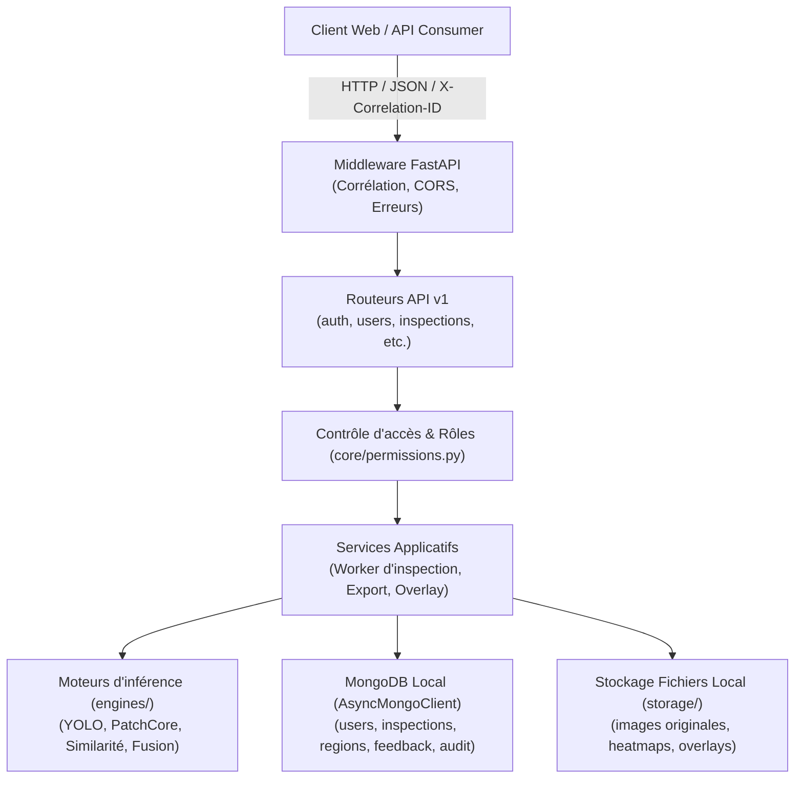

# Architecture Technique — Backend WeaveGuard AI

Ce document décrit l'organisation technique, les flux de données, les règles de sécurité et les frontières du système backend de **WeaveGuard AI**.

---

## 1. Vue d'ensemble du Système

WeaveGuard AI est une plateforme d'inspection textile assistée par vision par ordinateur, combinant trois moteurs d'IA complémentaires sans jamais les confondre :
1. **YOLOv8** : Détection supervisée de défauts textiles connus (`best.pt`).
2. **PatchCore** : Détection non supervisée d'anomalies atypiques (`memory_bank.pt`).
3. **Similarité FAISS** : Recherche visuelle dans les galeries de référence WeaveGuard v2 et DTD (`index_weaveguard.faiss`, `index_dtd.faiss`).

---

## 2. Périmètre des Données et Modèles

### 2.1 Sources autorisées (Lecture seule)
Le backend exploite exclusivement les répertoires et fichiers suivants :
* `models/weaveguard_yolo_v1/` : Modèle YOLO (`best.pt`, `model_card.json`).
* `models/patchcore/patchcore_v1/` : Banque de mémoire PatchCore (`memory_bank.pt`, `calibration.json`, `model_card.json`).
* `models/similarity/similarity_v1/` : Index FAISS et métadonnées DTD & WeaveGuard (`config.json`, index `.faiss`, métadonnées `.json`).
* `models/fusion/fusion_v1/` : Spécification de fusion et corroboration (`fusion_spec.json`).
* `models/domain_bias_report_v1.json` : Rapport d'évaluation du biais de domaine.
* `data/images/` : Galerie de textures DTD (47 sous-dossiers).
* `datasets/` : Jeu de données textile WeaveGuard v2 (`images/`, `labels/`, `normal_crops/`, `dataset_stats.json`, `manifest.csv`).

### 2.2 Sources strictement interdites au backend
Les dossiers suivants sont issus de cycles d'expérimentation antérieurs ou de runs d'entraînement et ne doivent **jamais** être importés ni lus par le code applicatif :
* `data/BDFD9/`
* `data/hole_detection/`
* `models/yolo/` (runs `v8n_640`, `v8n_640_val`, `v8n_640_test`)

---

## 3. Matrice des Rôles et Droits d'Accès (§10)

L'accès à l'API est protégé par jetons JWT (HS256) et contrôlé côté serveur via les dépendances déclarées dans `backend/app/core/permissions.py` :

| Rôle | Périmètre et autorisations principales |
| :--- | :--- |
| **`operator`** | Créer des inspections, consulter ses propres inspections, télécharger overlays/heatmaps, effectuer la revue humaine (confirmer / rejeter / incertain), ajouter des commentaires. |
| **`supervisor`** | Consulter toutes les inspections, appliquer les filtres avancés, consulter les statistiques globales et décisions, exporter les données. |
| **`admin`** | Gestion complète des utilisateurs (création, modification, désactivation, réinitialisation de mot de passe), configuration globale, politique de conservation, consultation du journal d'audit. |
| **`ml_engineer`** | Consultation des versions de modèles, rapports d'évaluation et biais de domaine, recherche de similarité, export des annotations de retour (`quality_checked=false`). |
| **`auditor`** | Consultation en lecture seule des inspections autorisées, des exports et du journal d'audit complet. |

---

## 4. Persistance des Données (MongoDB local sous Windows)

L'accès aux données utilise le pilote officiel asynchrone `AsyncMongoClient` (PyMongo 4.17+).

### Collections et Index :
1. **`users`** : Comptes utilisateurs, hachage Argon2 (`argon2-cffi`), statut, horodatage de dernière connexion, suivi des échecs d'authentification.
   - Index unique sur `username`.
2. **`inspections`** : Fiches d'inspection traçant l'image, le statut, les moteurs exécutés, les versions et empreintes SHA-256 des artefacts, les latences découpées (pré/modèle/post).
   - Index sur `created_at` (décroissant), `created_by`, `status`, `engines.name`.
3. **`regions`** : Régions détectées (boîtes, scores, seuils, libellés). **Immuables** une fois l'inférence terminée.
   - Index sur `inspection_id`.
4. **`feedback`** : Historique des validations humaines en **ajout seul**. La décision courante correspond au document le plus récent pour une région donnée.
   - Index composé sur `region_id` + `created_at` (décroissant), et sur `inspection_id`.
5. **`audit_log`** : Traçabilité des actions sensibles (connexions, modifications d'utilisateurs, exports, changements de configuration).
   - Index sur `at` (décroissant), `user_id`.
6. **`settings`** : Paramètres applicatifs modifiables (politique de conservation, moteurs actifs).

---

## 5. Résilience et Matériel

* **VRAM mesurée** : 4 096 Mo (4 Go) sur NVIDIA GeForce GTX 1050 (Compute Capability 6.1, sm_61).
* **Mode dégradé MongoDB** : Si le service MongoDB n'est pas accessible au démarrage, le serveur démarre néanmoins. L'endpoint `/health` rapporte `database: down` et `status: degraded`, et les routes dépendantes de la base renvoient une erreur structurée `503 DATABASE_UNAVAILABLE`.
* **Repli CPU automatique** : Détection dynamique de l'accélération matérielle. En l'absence de CUDA ou en cas d'incompatibilité, le système bascule sur CPU sans planter.

